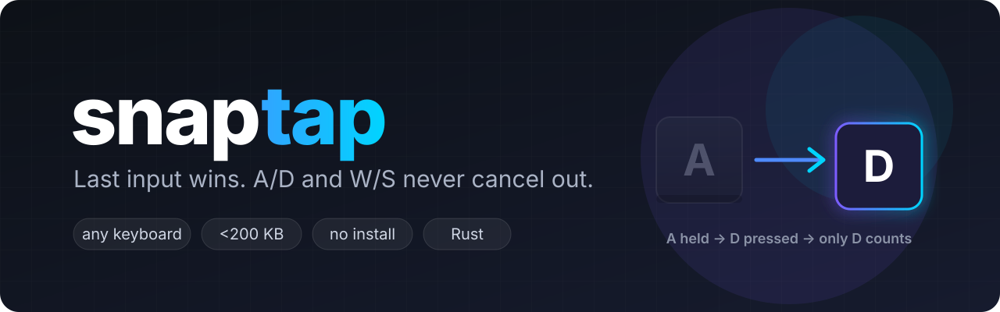
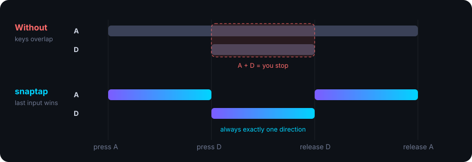
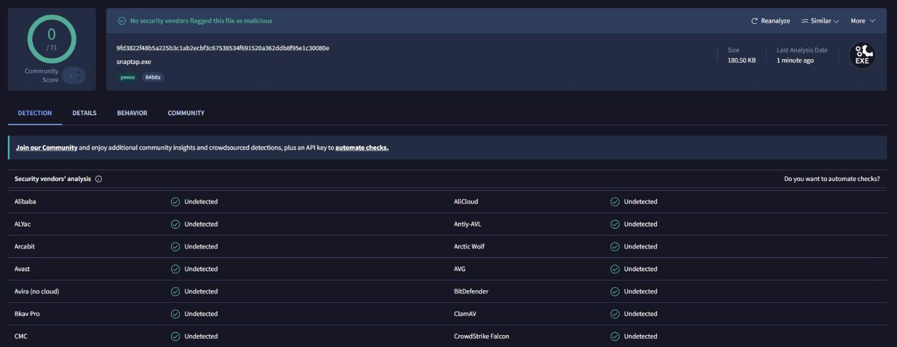

<p align="center">
  
</p>

<p align="center">
  <a href="https://github.com/attent10nc/snaptap/releases/latest"></a>
  <a href="https://github.com/attent10nc/snaptap/releases"></a>
  <a href="https://www.virustotal.com/gui/file/9fd3822f48b5a225b3c1ab2ecbf3c67538534f691520a362ddb8f95e1c30080e"></a>
  <a href="https://github.com/attent10nc/snaptap/actions/workflows/ci.yml"></a>
  
  <a href="LICENSE"></a>
</p>

<p align="center">
  Snap Tap (SOCD) for any keyboard. If you hold two opposite keys, the last one you pressed wins.
</p>

<p align="center">
  <a href="https://github.com/attent10nc/snaptap/releases/latest/download/snaptap.exe"><b>Download snaptap.exe</b></a>
  &nbsp;·&nbsp; <a href="#русский">Русский</a>
</p>

---

## What it does

<p align="center"></p>

| You do | The game gets |
|---|---|
| hold **A**, press **D** | A released, D pressed |
| release **D** while still holding **A** | A pressed again |
| hold **D**, press **A**, release **D** | nothing changes, A stays |

Works for A/D and W/S. Other keys aren't touched. No install, no admin rights, the exe is under 200 KB.

## Usage

Grab `snaptap.exe` from [releases](https://github.com/attent10nc/snaptap/releases/latest) and run it.
It prints `[ON]` when the game window is focused and `[OFF]` when it isn't.

```text
snaptap.exe              active while cs2.exe is focused (default)
snaptap.exe game.exe     active while game.exe is focused
snaptap.exe --global     active in every window
```

Ctrl+C or just close the window to quit.

> [!WARNING]
> Valve kicks for snap tap in matches on official CS2 servers (since Aug 2024). Check the rules of wherever you play.

## Antivirus / safety

v1.0.0 on VirusTotal: 0/71 ([report](https://www.virustotal.com/gui/file/9fd3822f48b5a225b3c1ab2ecbf3c67538534f691520a362ddb8f95e1c30080e)).
The release exe is built by [GitHub Actions](https://github.com/attent10nc/snaptap/actions/workflows/release.yml) from this repo,
sha256 is in `SHA256SUMS.txt` next to it:

```
9fd3822f48b5a225b3c1ab2ecbf3c67538534f691520a362ddb8f95e1c30080e  snaptap.exe
```

All the code is in [`src/main.rs`](src/main.rs). No network, no files, no registry.

<p align="center">
  <a href="https://www.virustotal.com/gui/file/9fd3822f48b5a225b3c1ab2ecbf3c67538534f691520a362ddb8f95e1c30080e"></a>
</p>

If your AV ever complains: it's a global keyboard hook + SendInput, which some heuristics don't like on unsigned exes.
Nothing gets logged or sent anywhere, build it yourself if you want to be sure.

## How it works

Low-level keyboard hook (`WH_KEYBOARD_LL`) keeps track of what's physically held. When you press the opposite
key, the real event is blocked and it sends `old key up` + `new key down` via `SendInput`. Let go of the new key and
the old one gets pressed again if you're still holding it. Own events are tagged in `dwExtraInfo` so the hook skips them.

## Building

```bash
git clone https://github.com/attent10nc/snaptap
cd snaptap
cargo test
cargo build --release
```

Pushing a `v*` tag builds a release.

---

## Русский

Snap tap для любой клавы. Держишь A, жмёшь D: игра видит только D. Отпустил D, снова идёт A.
Не бывает такого, что A и D зажаты вместе и персонаж встаёт.

Качаешь `snaptap.exe` из релизов и запускаешь. По умолчанию работает только в CS2,
`snaptap.exe game.exe` для другой игры, `snaptap.exe --global` везде.

VirusTotal 0/71 ([отчёт](https://www.virustotal.com/gui/file/9fd3822f48b5a225b3c1ab2ecbf3c67538534f691520a362ddb8f95e1c30080e)), exe собирается через GitHub Actions, код открыт.
На официальных серверах Valve в матчах за snap tap кикают, имей в виду.

## License

[MIT](LICENSE)
